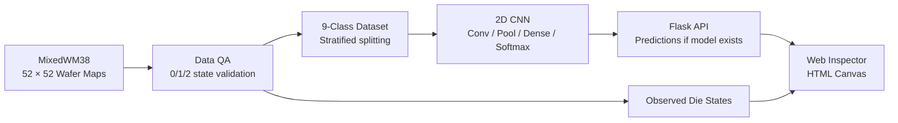

# WAFER MAP | CNN DEFECT INSPECTOR
### Semiconductor Wafer Map Defect Classification & Interactive Quality Inspection

**반도체 웨이퍼 맵 불량 패턴 분류 · CNN 기반 품질 데이터 분석 · 인터랙티브 검사 시스템**

**Gachon University | Department of Industrial Engineering**  
**InFact — Campus Academic Society Project Context / 가천대학교 InFact 교내 학회 프로젝트**

> **Repository status / 저장소 상태:** This README is the initial published overview. The original source, photographed evidence, bilingual PDFs and full visual gallery are prepared in the separate project package and **not yet uploaded to this repository**. Do not interpret this initial README as a claim that the complete project or trained model has already been published.  
> **검증 범위:** 데이터 검증과 프로젝트 문서에 기반한 설명입니다. 실제 학습 가중치, CNN Accuracy, Macro-F1, Confusion Matrix는 아직 독립적으로 확인되지 않았으며, 성능 수치를 임의로 기재하지 않았습니다.

## 01 / Project motivation · 문제의식

**한국어.** Wafer Test 또는 EDS 이후 기록되는 다이별 PASS/FAIL 결과는 단순한 불량률 이상을 설명할 수 있습니다. 동일한 FAIL 비율이라도 중앙(Center), 가장자리 링(Edge-Ring), 스크래치(Scratch)처럼 공간 분포가 다를 수 있습니다. 저는 52×52 웨이퍼 맵을 CNN에 입력해 결함 패턴을 분류하는 모델을 구성하고, 웹에서 각 Die의 상태와 위치를 확인할 수 있는 검사 인터페이스를 개발했습니다.

**English.** This project explores spatial defect-pattern screening from 52×52 post-test wafer maps. A baseline CNN is designed to classify nine normal/single-defect patterns. A Flask + HTML Canvas interface supports die-level inspection, observed PASS/FAIL counts, and model prediction display when trained weights are available. It is **not** SEM micro-defect detection or a validated production yield-prediction system.

## 02 / Research flow · 분석 구조

## 03 / Technical stack · 사용 기술

| Layer | Technology | Implementation / 의미 |
|---|---|---|
| Data processing | Python, NumPy | Wafer-map tensor transformation, source validation |
| ML pipeline | scikit-learn | Stratified train/validation/test split, imbalance management |
| Deep learning | TensorFlow / Keras | Conv2D, ReLU, MaxPooling, global pooling, 9-way Softmax |
| Web backend | Flask | Sample lookup and conditional model inference |
| UI / visualization | HTML Canvas, JavaScript | 52×52 die display, hover coordinates, FAIL/PASS count |
| Quality assurance | Python tests | Dataset-shape and die-state validation |

## 04 / Dataset audit · 데이터 검증

| Item | Count | Interpretation |
|---|---:|---|
| MixedWM38 source maps | **38,015** | Original research archive |
| Normal + eight single-defect patterns | **8,015** | Nine-class candidate set |
| Mixed-pattern maps excluded | **30,000** | Excluded from single-label scope |
| Out-of-spec code `3` | **105** | Entire maps isolated pending semantic verification |
| Validated single-label maps | **7,910** | Only die states `0,1,2` |

**Nine classes / 분류 대상:** Normal · Center · Donut · Edge-Loc · Edge-Ring · Loc · Near-Full · Scratch · Random.

**Input definition:** `0 = outside wafer`, `1 = PASS`, `2 = FAIL`. A cell value `3` was observed in 105 candidate maps but is not defined in the project's source description, so those maps are isolated rather than silently reinterpreted. These are **data-quality findings**, not CNN prediction metrics.

## 05 / InFact · 교내 학회 활동

The work is documented in the context of **InFact**, an academic society associated with Gachon University's Industrial Engineering student community. The society's project midterm presentation notice lists **October 30, 2026 (Friday), 18:30, Vision Tower Room 318**, with a presentation duration of up to 10 minutes. This is an announced event, **not evidence of actual attendance, completed presentation, or awards**.

**한국어.** InFact 교내 학회 프로젝트 맥락에서 CNN 구현만이 아니라, 제조 품질의 문제 정의, 데이터 이상치 검증, 모델 설계, 웹 시각화, 결과의 검증 가능성과 한계까지 하나의 기술 포트폴리오로 정리하고 있습니다.

[InFact Instagram](https://www.instagram.com/gcu_infact/)

## 06 / Engineering relevance · 산업공학적 의미

- **Yield analysis / 수율 분석:** Spatial defect patterns add diagnostic context beyond a single fail-die ratio.
- **Quality engineering / 품질공학:** Consistent screening of recurring wafer-level spatial patterns.
- **Data integrity / 데이터 품질:** Explicit rejection of undocumented values before model training.
- **Decision support / 의사결정지원:** A foundation for linking defect-pattern alarms to tool/lot/process metadata in later research.
- **Reproducibility / 재현 가능성:** Distinguish observed counts, source labels, model predictions, and metrics that remain unverified.

**Important limitation / 한계:** Without lot history, equipment information or process parameters, defect-map appearance alone cannot establish a causal root cause or a realized improvement in semiconductor production yield.

## 07 / Next publication steps · 자료 정리 현황

The complete prepared project package additionally contains reconstructed Python/Flask source code, the original Korean and English technical-report PDFs, nine source-data wafer-map examples, data-analysis figures, interface captures and two InFact activity screenshots. These assets should be uploaded together so that the final graphical README has **no missing images or unsupported performance claims**.

### Dataset / Reference
- [MixedWM38 research repository — Junliangwangdhu/WaferMap](https://github.com/Junliangwangdhu/WaferMap)

---
Original project reports: 2026-10-05 · InFact documentation update: 2026-10-29 · Independent student portfolio, not an industrial deployment.
