<div align="center">

# WAFER MAP | CNN DEFECT INSPECTOR
### 52×52 Die-level Quality Analytics · Spatial Pattern Classification · Interactive Inspection

**반도체 웨이퍼 맵 불량 패턴 분류 및 인터랙티브 분석 시스템**

     

**Shin Do-yun | 신도윤** · Department of Industrial Engineering, Gachon University  
**Campus project context:** InFact / 인팩트, Gachon University Industrial Engineering academic society  
**Original project archive & reports:** 2026.10.05 · **Portfolio / QA documentation update:** 2026.10.29

</div>

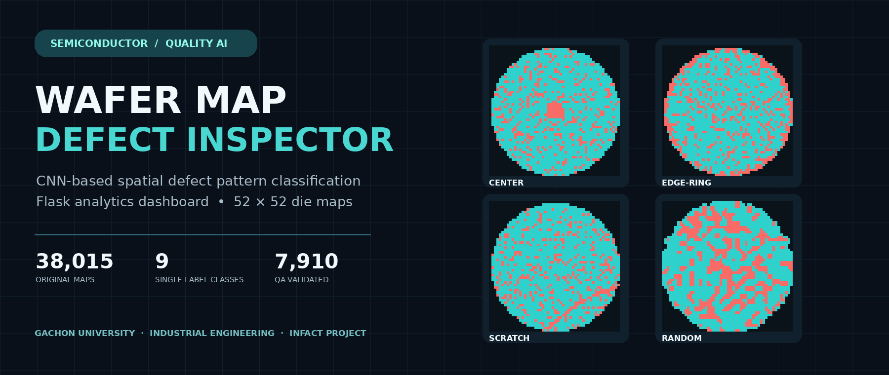

<div align="center">

[**한국어 안내**](README_KR.md) · [**Project Technical Notes**](docs/TECHNICAL_DEEP_DIVE.md) · [**InFact Activity Context**](docs/INFACT_ACTIVITY.md) · [**Dataset Audit**](docs/DATA_AUDIT.md) · [**Verification**](docs/VERIFICATION_STATUS.md) · [**Repo metadata**](docs/GITHUB_REPOSITORY_PROFILE.md) · [**KR Report · PDF**](reports/Wafer_CNN_Project_Report_KR.pdf) · [**EN Report · PDF**](reports/Wafer_CNN_Project_Report_EN.pdf)

</div>

> **Scope & honesty / 프로젝트 범위**  
> This is a **recovered and documented student research prototype**, not an industrial deployment. The original Flask source and bilingual reports were recovered from the October 5, 2026 files. This repository improves data validation, portability, and documentation. **Trained weights, test accuracy, Macro-F1, and confusion matrix were not found or independently verified. There are no fabricated model results in this repository.**  
> 2026년 10월 5일 작성된 원본 소스와 보고서를 기반으로 재구성했습니다. 웨이퍼 맵의 실제 결함 분포, 전처리, 분석 UI, CNN 모델 구현을 설명하지만 **실제로 측정되지 않은 CNN 성능과 현장 수율 개선 효과는 주장하지 않습니다.**

---

## 01. Why this project? | 프로젝트의 출발점

반도체 공정의 품질 데이터를 공부하면서 관심이 생긴 것은 단순히 **불량이 몇 개나 발생했는가**가 아니라, **불량이 웨이퍼의 어느 위치에 어떤 공간적 형태로 나타났는가**였습니다. 같은 불량률을 기록한 웨이퍼라도 가장자리를 따라 불량이 집중되는 경우와 중앙에 집중되는 경우는 다르게 해석해야 합니다. 이 차이를 모델이 학습하게 하고, 사람은 실제 다이(Die) 상태를 웹에서 확인하도록 만들었습니다.

**English.** Rather than treating wafer quality as a single scalar failure rate, I explored whether a CNN could recognize spatial patterns in post-test die maps. I coupled the model pipeline with an interactive inspection interface so an analyst can inspect individual cells, see the original class label, and review predictions **when a trained model exists**. The objective is transparent *screening and inspection support*, not unsupported process-root-cause attribution.

| Engineering question | What I built / 무엇을 구현했는가 |
|---|---|
| **How can spatial patterns be represented?** | 52×52 integer wafer maps → normalized 2D CNN inputs |
| **How should class imbalance be handled?** | Stratified data split + training-fold class weighting |
| **Can invalid source values contaminate analysis?** | Valid die-state screening; 105 out-of-spec maps isolated |
| **How can inspection be made interpretable?** | Canvas die visualization, PASS/FAIL counts, hover coordinates, model readiness status |
| **How should model quality be communicated?** | Separate original source, data QA, verified tests and unverified training metrics |

---

## 02. Visual evidence | 실제 데이터와 인터페이스

### 2.1 Nine wafer-map classes · 실제 원본 데이터 기반 9종 패턴

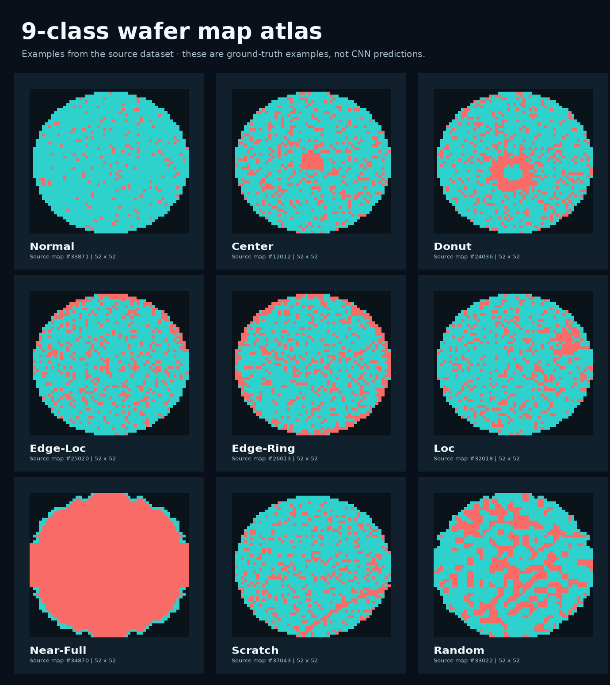

<sub>**Figure 1.** These nine examples are **original source-data samples selected by class label**—not CNN predictions or synthesized example maps. Color mapping: dark = outside wafer; turquoise = PASS; coral = FAIL. / 원본 데이터에서 추출한 라벨별 웨이퍼 맵이며 모델 예측 결과가 아닙니다. 이미지별 원본 인덱스는 [`evidence/source_map_selection.json`](evidence/source_map_selection.json)에 남겼습니다.</sub>

| Normal | Center | Donut |
|:---:|:---:|:---:|
| 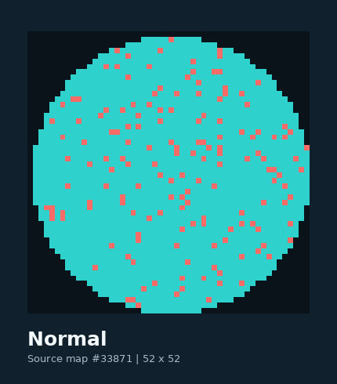 | 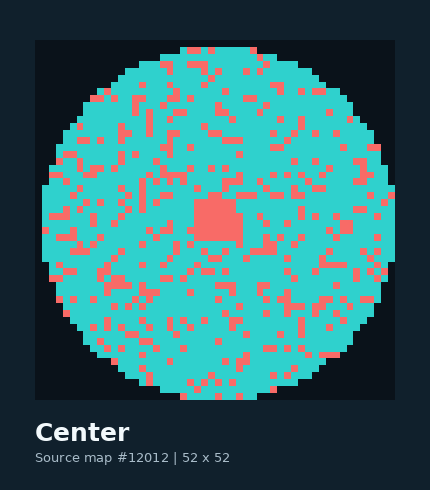 | 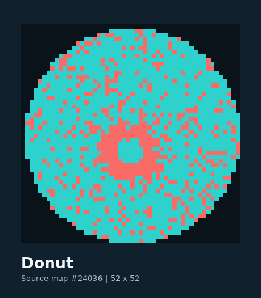 |
| Edge-Loc | Edge-Ring | Loc |
| 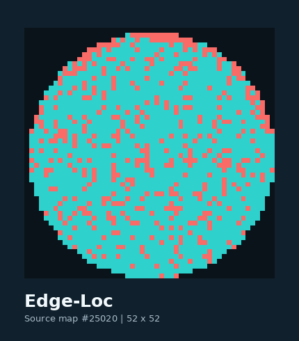 | 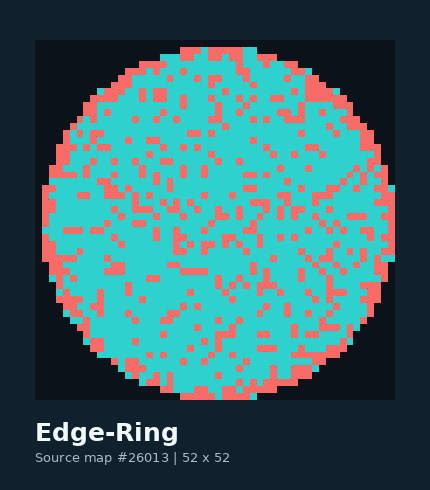 | 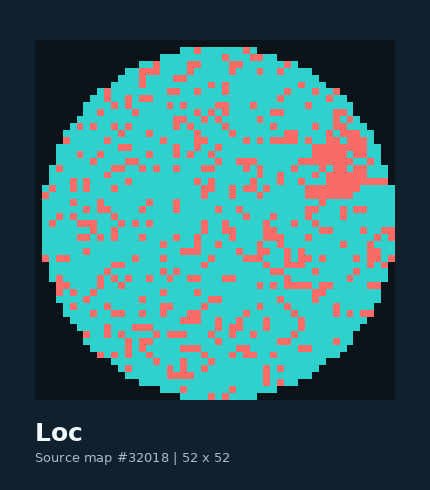 |
| Near-Full | Scratch | Random |
| 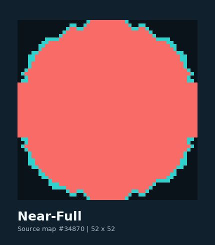 | 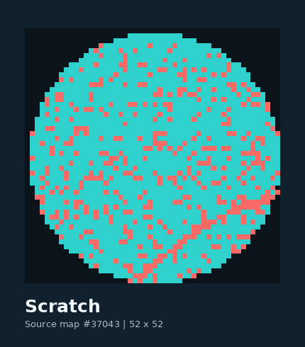 | 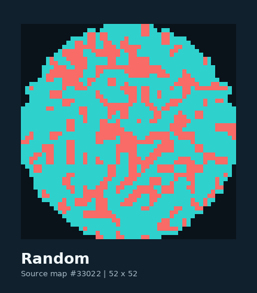 |

**Class meaning / 라벨 해석** — Normal(지배적 패턴 없음), Center(중앙형), Donut(도넛형), Edge-Loc(가장자리 국소형), Edge-Ring(가장자리 링), Loc(국소형), Near-Full(광범위 불량), Scratch(선형), Random(불규칙). These are **pattern classes**, not process-equipment diagnoses.

### 2.2 Interface preview · 실제 템플릿과 데이터로 렌더링한 UI

| **Edge-Ring: original wafer data** | **Center: original wafer data** |
|:--:|:--:|
| 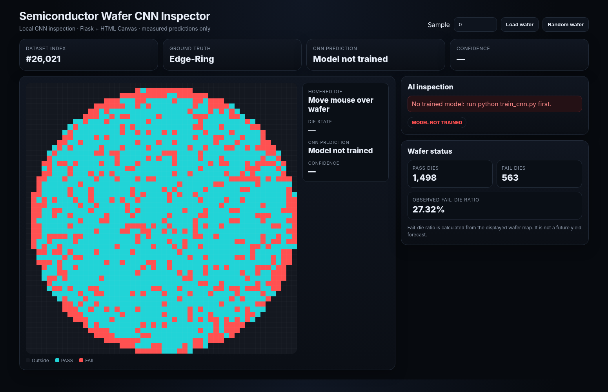 | 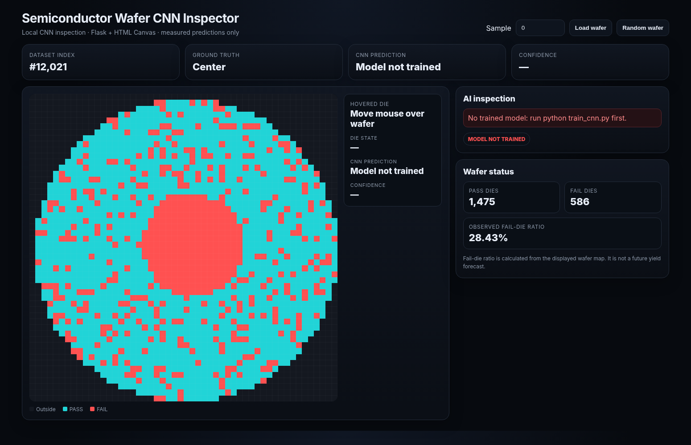 |
| Source index `#26,021` / dataset label `Edge-Ring` | Source wafer map / dataset label `Center` |

<sub>**Screenshot provenance.** These are browser renderings of the **recovered `templates/index.html`**, populated with actual validated MixedWM38 samples through a local response fixture because Flask was not available in the packaging runtime. They **are not proof of a live Flask/TensorFlow end-to-end run**. The UI correctly shows **“Model not trained”** and leaves CNN confidence empty. See [`docs/IMAGE_PROVENANCE.md`](docs/IMAGE_PROVENANCE.md). / 캡처 화면은 원본 HTML 템플릿과 실제 웨이퍼 샘플을 이용한 로컬 렌더링이며, 모델이 없는 상태를 그대로 표시했습니다.</sub>

### 2.3 Architecture · 처리 흐름

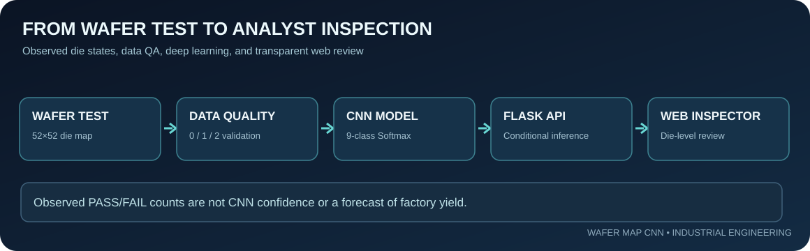

1. **Post-test maps / 입력** — Electrical Die Sorting (EDS) or Wafer Test results are expressed as cell-level PASS/FAIL maps.
2. **Validation / 검증** — Select normal and single-pattern maps; reject undocumented cell values without silently relabeling them.
3. **Training / CNN** — Learn spatial features with Conv2D, pooling, dropout and a 9-way softmax head; measure performance on a held-out set.
4. **Serving / Flask** — Return class labels, observed die counts and model predictions (only if a saved model is available).
5. **Inspection / Web UI** — Browse source samples, inspect die positions and distinguish observed cell counts from inferred class probabilities.

---

## 03. InFact · Gachon University campus research context

이번 작업은 산업공학 전공과 연계해 진행한 **가천대학교 교내 학회 InFact 프로젝트 활동**의 맥락에서 정리하고 있습니다. CNN 모델 하나를 돌리는 것으로 끝내지 않고, 데이터 출처·전처리 근거·웹 시각화·재현 가능성·한계를 하나의 연구 기록으로 묶었습니다.

**English.** I organized this wafer-map study as a technical deliverable in the context of my Gachon University InFact campus academic-society project work. The repository is intended to document implementation, engineering reasoning, and presentation preparation, rather than exaggerate a course exercise into a published research result.

| **InFact public Instagram profile / 학회 계정 캡처** | **Project midterm notice / 프로젝트 중간발표 공지** |
|:--:|:--:|
|  | 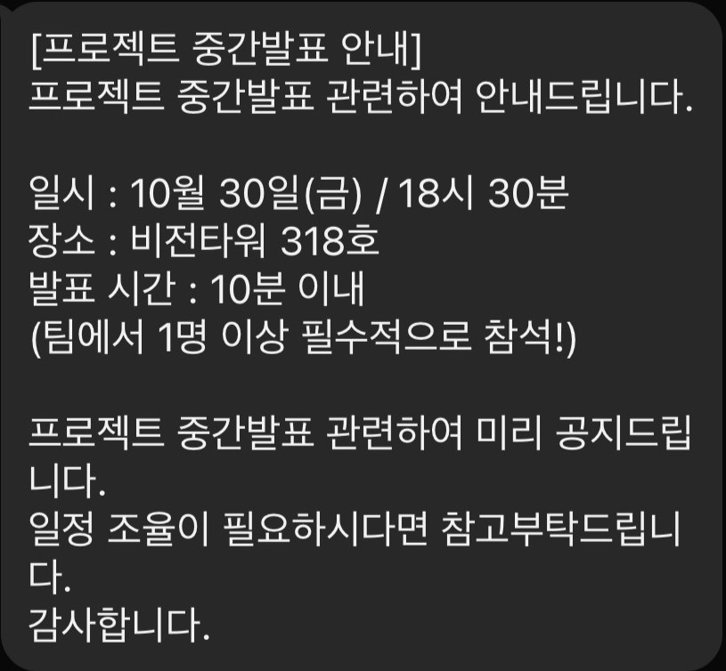 |

**Midterm presentation / 중간발표 안내**: **2026.10.30 (Fri) 18:30 · Vision Tower Room 318 · presentation within 10 minutes**. At the time of this README update (2026.10.29), this is a **scheduled activity**, not a completed presentation or an award. The notice requires at least one team member to attend; it does **not** by itself verify individual attendance or the final presentation outcome. / 캡처는 행사 일정과 학회 활동 맥락을 보여주는 자료로, 참석·수상 증명 자료로 사용하지 않았습니다.

[**More on the InFact context / 중간발표 소개 및 발표 흐름**](docs/INFACT_ACTIVITY.md) · [**InFact Instagram account**](https://www.instagram.com/gcu_infact/)

---

## 04. Data analysis | MixedWM38 & quality audit

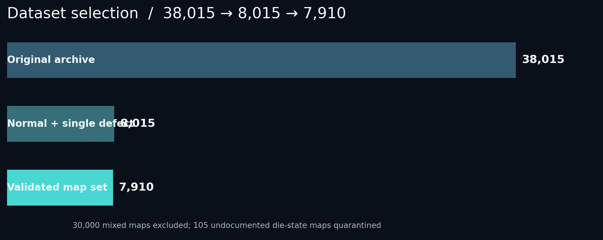

The archived dataset contains **38,015** maps, each **52×52**. The research scope is nine *single-label* classes: one normal class and eight single-defect classes. The additional **30,000 multi-pattern samples are deliberately excluded**, not counted as failures. Cell values defined in the supplied data description are `0 = outside`, `1 = PASS`, `2 = FAIL`.

| Check / 검증 단계 | Count / 결과 | Evidence |
|---|---:|---|
| Raw archive / 원본 맵 | **38,015** | `arr_0.shape == (38015,52,52)` |
| Normal + exactly one defect | **8,015** | `arr_1` multi-hot label sum ≤ 1 |
| Mixed-type maps excluded | **30,000** | Labels with ≥2 defect indicators |
| Unrecognized die state `3` | **105** | Not defined in supplied description; full maps quarantined |
| **Validated single-label maps** | **7,910** | Only `0,1,2` die states retained |

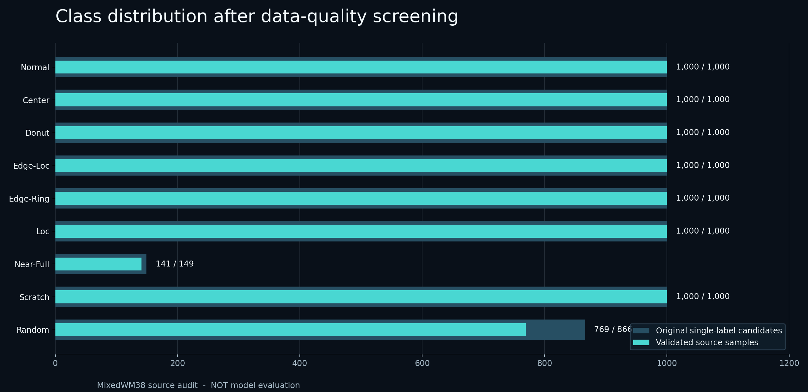

<sub>**Figures 2–3.** Counts are **actual source-file data audits**, not classification accuracy or a synthetic benchmark. Of 105 excluded maps, 97 are Random and 8 are Near-Full. / 105개 전체 샘플을 배제했으며 값 `3`에 임의의 의미를 부여하거나 원본 데이터에 덮어쓰지 않았습니다.</sub>

**Why this matters / 왜 중요한가?** A CNN can learn patterns from incorrectly encoded data just as easily as from correct data. During recovery, I found that the older code would treat values not matching PASS/FAIL as outside-wafer cells in visualization while normalizing the input by division by two. I therefore made the new data gate *explicit and reproducible*. / 원본 데이터의 이상값을 무시하면 지도 모양 자체가 달라질 수 있으므로, 전처리 단계에서 검증 규칙을 명문화했습니다.

- Detailed source QA: [`docs/DATA_AUDIT.md`](docs/DATA_AUDIT.md)
- Selected example source indices: [`evidence/source_map_selection.json`](evidence/source_map_selection.json)
- Reproduce the two QA graphs: `python -m pip install -r requirements-figures.txt` then `python analysis/generate_audit_figures.py --data /path/to/Wafer_Map_Datasets.npz`
- Original research dataset: [Junliangwangdhu / WaferMap — MixedWM38](https://github.com/Junliangwangdhu/WaferMap)

---

## 05. CNN baseline | 모델 구조와 학습 설계

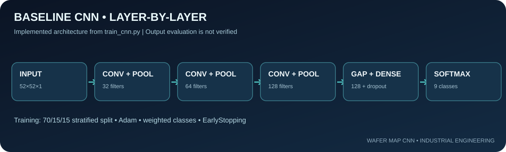

<sub>**Figure 4.** Architecture directly summarized from `train_cnn.py`; it is a code-structure diagram, not measured classifier performance. / 실제 CNN 정의에 있는 층을 시각화한 모형도입니다.</sub>

The aim is a transparent **baseline CNN**, not the most complex architecture. / 목표는 과도하게 복잡한 모델이 아니라, 2차원 결함 패턴의 특징을 학습하는 과정을 구현하고 평가 가능한 기준 모델을 만드는 것입니다.

```text
Input: 52 × 52 × 1             raw die codes [0, 1, 2] / 2.0
    │
Conv2D(32, 3×3, ReLU)        → MaxPooling2D
    │
Conv2D(64, 3×3, ReLU)        → MaxPooling2D
    │
Conv2D(128, 3×3, ReLU)       → MaxPooling2D
    │
GlobalAveragePooling2D
    │
Dense(128, ReLU) → Dropout(0.3)
    │
Dense(9, Softmax)            → nine class probabilities
```

| Part / 구성 | Exact implementation / 실제 코드 설정 | Engineering reason / 선택 근거 |
|---|---|---|
| Data preparation | 52×52×1, values divided by `2.0` | Preserve die geometry, map to `[0,1]` |
| Class strategy | 1 normal + 8 single defect types | Baseline single-label classification |
| Split | **70 / 15 / 15**, stratified, seed **42** | Separate train/validation/holdout test |
| Imbalance | `compute_class_weight("balanced")` on training labels | Avoid treating 141 Near-Full samples like 1,000-class majority |
| Optimization | `Adam(1e-3)` + sparse crossentropy | Standard multi-class baseline |
| Training safety | EarlyStopping (patience 4); ReduceLROnPlateau (patience 2) | Stop or reduce LR with validation-loss plateau |
| Evaluation outputs | Accuracy, Macro-F1, confusion matrix, per-class results | Do not infer quality from training accuracy alone |

**Evaluation policy / 성능 기록 원칙:** The script writes measured results to `outputs/evaluation.json` **only after an actual train-and-test run**. I have not committed an invented accuracy number or a decorative confusion matrix. When weights do not exist, the UI explicitly displays **MODEL NOT TRAINED**.

[**Detailed implementation notes / 모델 및 검증 기술 해설**](docs/TECHNICAL_DEEP_DIVE.md) · [**Training code**](train_cnn.py)

---

## 06. Interactive inspection | 검사 화면의 의미

The application is built with **Python/Flask** and a light **HTML/CSS/JavaScript Canvas** interface. It is a local engineering dashboard, not a deployed equipment connector.

| Function / 기능 | What it actually does / 동작 |
|---|---|
| Sample explorer | Position input and randomized map selection / 웨이퍼 샘플 탐색 |
| Die-level hover | `X/Y` index and PASS/FAIL/outside state / 다이 좌표와 상태 확인 |
| Observed metrics | PASS count; FAIL count; `FAIL/(PASS+FAIL)` / 관측 불량 비율 |
| CNN inference | Prediction, Top-5 softmax and confidence **only if model is loaded** |
| Ground truth | Shows original dataset class; makes it possible to compare with prediction |
| Error handling | Missing model = explicit warning; no fake `0%` confidence |

**Important interpretation / 해석 주의:** the displayed fail-die ratio is an observed property of the sample. It is **not** a predicted future wafer yield, not equipment fault localization, and not a causal explanation for a fabrication recipe problem. / 화면의 불량률은 현재 표본의 관측값입니다. 공정 원인이나 향후 수율을 자동으로 추정한 수치가 아닙니다.

---

## 07. What I learned / 산업공학적 의미

이 프로젝트에서 가장 중요하게 본 것은 **AI 모델의 점수**보다, 검사 목적에 맞는 데이터 구조와 결과 해석입니다. 52×52 맵은 숫자 2,704개의 나열이 아니라 반도체 다이의 배치 정보를 담고 있습니다. 패턴은 그 배치를 유지해야만 의미를 가집니다. 또한 Near-Full과 Random처럼 샘플이 적은 클래스가 있어, 전체 정확도 하나로는 모델의 편향을 판단하기 어렵습니다.

**English.** The practical contribution here is the *architecture of an inspection workflow*: source traceability → data validation → reproducible baseline training → per-map visual inspection. This is a useful starting point for semiconductor quality analysis, but it is not proof of measurable yield gain in production.

**Potential applications (not yet implemented):**

- **Quality / Yield Analytics:** triage recurring spatial fail patterns before manual review.
- **Product Engineering / Evaluation & Analysis:** link map clusters to lot, test-step and equipment records for investigation.
- **Manufacturing Data Engineering:** flag undocumented die codes and monitor distribution drift.
- **Explainable AI:** Grad-CAM, class-wise calibration, confidence thresholds and human review.

**Not claimed / 주장하지 않는 범위:** root cause identified, factory acceptance, manufacturing time saved, product yield improved, competitive award earned, midterm presentation delivered, or high CNN accuracy measured.

---

## 08. Local reproduction | 실행 방법

The public repository contains source code, tests, small examples and reports. **It does not redistribute the 412 MB uncompressed source NPZ or pre-trained weights.** Download the data from the original research source or extract your already-owned archival dataset.

```bash
# Python 3.11 is recommended for compatible TensorFlow builds
python -m venv .venv

# Windows PowerShell
.venv\Scripts\Activate.ps1
# Linux/macOS: source .venv/bin/activate

python -m pip install -r requirements.txt
```

```powershell
# Windows PowerShell example — point to your legitimate copy of the source dataset
$env:WAFER_DATA_PATH = 'C:\path\to\Wafer_Map_Datasets.npz'

# Step A: train and calculate real metrics (run locally)
python train_cnn.py --epochs 20 --batch-size 64 --seed 42

# Step B: inspect the wafer maps
python app.py
```

Browse `http://127.0.0.1:5000`. The app can show source maps without a trained model; its prediction box will correctly indicate missing weights. The environment-dependent training step has **not** been executed as part of this GitHub packaging task. / 로컬 TensorFlow 학습을 실제로 실행해야만 Accuracy, F1, 혼동행렬을 결과 파일에 기록합니다.

### Source & technical documents

| Contents | Path |
|---|---|
| Flask API / 웹 서비스 | [`app.py`](app.py) |
| TensorFlow training / CNN 모델 | [`train_cnn.py`](train_cnn.py) |
| Dataset QA / 데이터 검증 | [`wafer_data.py`](wafer_data.py) |
| HTML Canvas interface / 인터페이스 | [`templates/index.html`](templates/index.html) |
| Unit tests / 기능 검사 | [`tests/test_wafer_data.py`](tests/test_wafer_data.py) |
| Data charts (reproducible) | [`analysis/generate_audit_figures.py`](analysis/generate_audit_figures.py) |
| Korean original technical report · 12pp | [`reports/Wafer_CNN_Project_Report_KR.pdf`](reports/Wafer_CNN_Project_Report_KR.pdf) |
| English original technical report · 12pp | [`reports/Wafer_CNN_Project_Report_EN.pdf`](reports/Wafer_CNN_Project_Report_EN.pdf) |
| Audit and transparency | [`docs/DATA_AUDIT.md`](docs/DATA_AUDIT.md) · [`docs/VERIFICATION_STATUS.md`](docs/VERIFICATION_STATUS.md) |

---

## 09. From report to prototype | 연구 보고서 기록

The following are rendered previews of the **October 5, 2026 original written report**, not newly fabricated experimental screenshots. / 기존 국·영문 보고서의 실제 페이지 미리보기입니다.

| Project report | Dataset discussion | CNN architecture / pipeline |
|:--:|:--:|:--:|
| 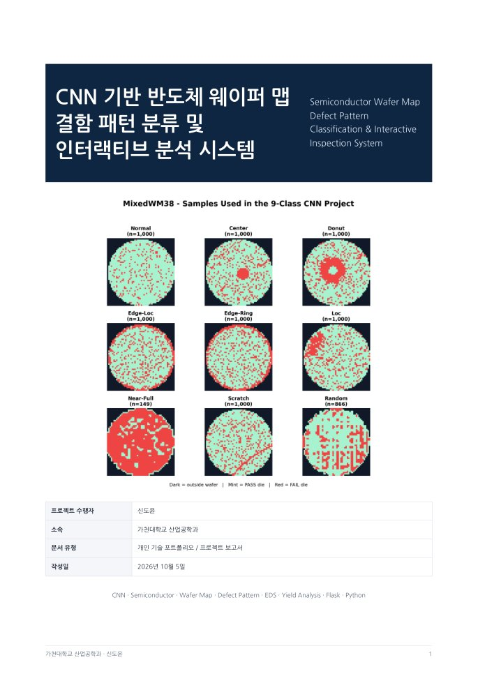 | 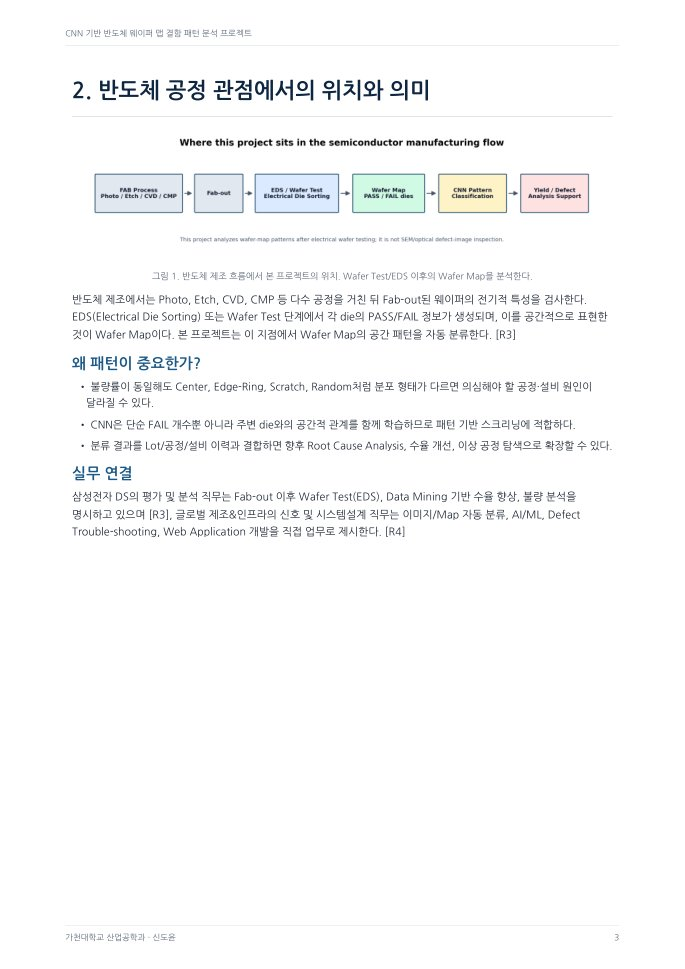 | 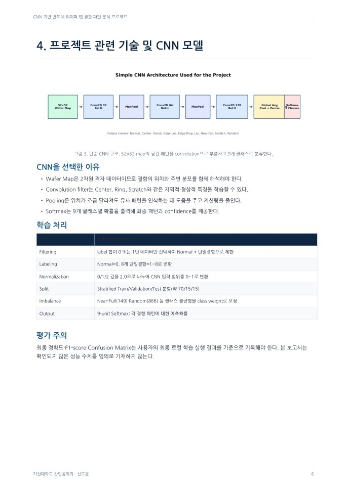 |
| Wafer-map report cover | Wafer test context | CNN model explanation |

| System architecture | Illustrative UI in report |
|:--:|:--:|
| 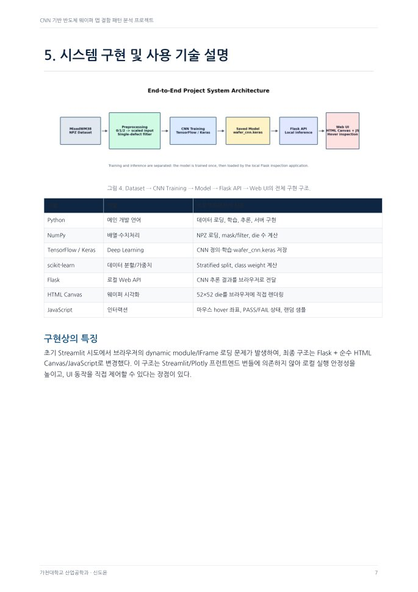 | 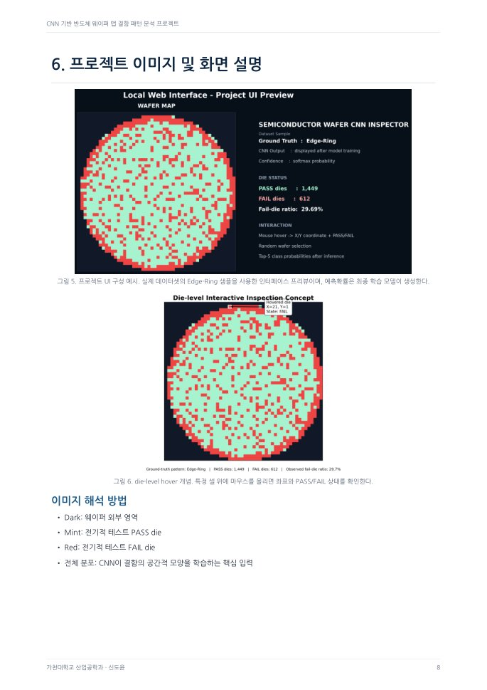 |

**Figure note:** The report's UI illustration is a **report preview**, distinct from the browser-rendered prototype screenshot in §2.2. Original reports predate the October 29 data-quality update, so the reports' historical 8,015 candidate maps and this repository's cleaned 7,910 maps are both explained above.

---

## 10. Roadmap | 다음 단계

| Priority | Next engineering step | Why it matters / 목적 |
|---|---|---|
| 1 | Execute training with frozen environment and archived seed | Obtain actual Accuracy, Macro-F1 and confusion matrix |
| 2 | Per-class error analysis; Near-Full / Random sensitivity | Detect minority-class failures missed by overall accuracy |
| 3 | Make a clean external or grouped holdout | Check whether augmentation overlap inflates reported generalization |
| 4 | Mixed-type wafer maps as multi-label classification | Support broader set of defect patterns |
| 5 | Visual explanation and confidence calibration | Make model review defensible |
| 6 | Integrate lot / tool / recipe histories in a properly governed dataset | Move from *pattern recognition* toward *investigative* manufacturing analytics |

> **Provenance / 출처 및 한계.** Source dataset: [MixedWM38 WaferMap project](https://github.com/Junliangwangdhu/WaferMap). Campus-activity screenshots were supplied for this portfolio. Visual diagrams and audit plots were generated from local source data or code; no photos of a factory, AI-generated fabrication results or unverified model metrics are presented as evidence. See [image provenance](docs/IMAGE_PROVENANCE.md). No confidential company manufacturing data were used.