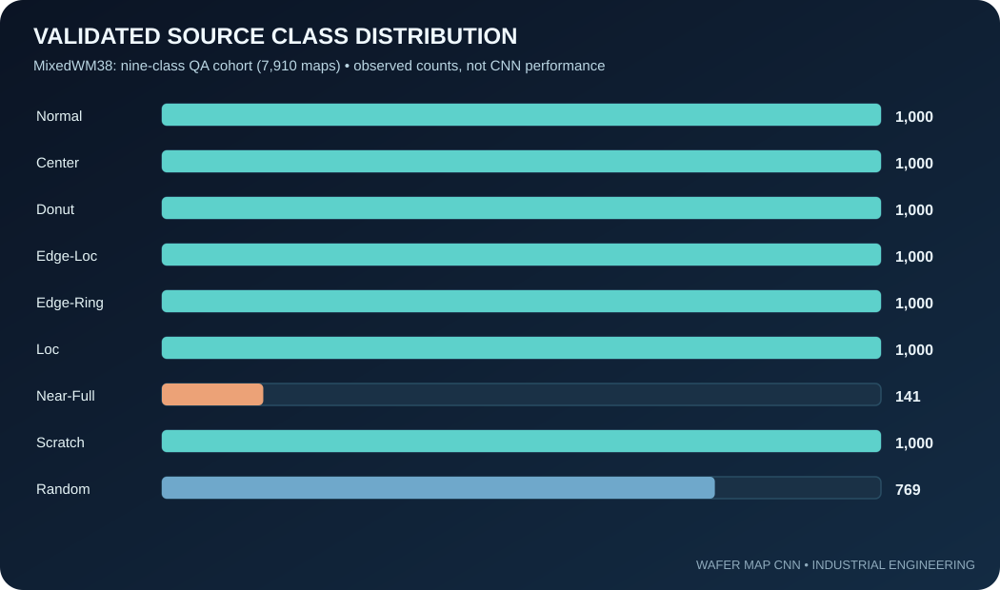

# Dataset audit | MixedWM38

## Recorded source checks

| Audit | Value |
|---|---:|
| Raw maps | 38,015 |
| Each map | 52 × 52 |
| Nine-class normal/single candidates | 8,015 |
| Mixed-type omitted | 30,000 |
| Nine-class candidates containing undocumented die code 3 | 105 |
| Final validation cohort | **7,910** |

There is no documented reason to silently map code 3 to outside/PASS/FAIL, so whole affected maps are quarantined for the reproducible baseline.

## Class counts in the validated cohort
Normal 1,000; Center 1,000; Donut 1,000; Edge-Loc 1,000; Edge-Ring 1,000; Loc 1,000; Near-Full 141; Scratch 1,000; Random 769.

The counts are **source dataset statistics, not measured model outcomes**. See wafer_data.py for programmatic validation and label conversion.

[Source map records](../evidence/source_map_selection.json) · [Original public dataset](https://github.com/Junliangwangdhu/WaferMap)
