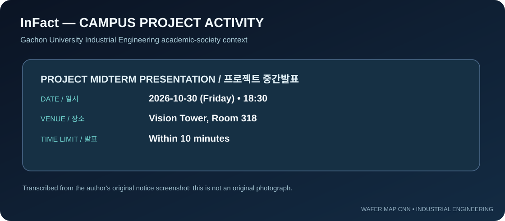

# InFact | Gachon University campus project context

This is a university academic-society context document, **not** a certificate of membership or proof of attendance.

## Midterm announcement
- Announced date: **October 30, 2026 (Friday)**.
- Start: **18:30 / 6:30 PM**.
- Venue: **Vision Tower, Room 318**.
- Time limit: **within 10 minutes**.
- Participation notice: at least one team member must attend.

The diagram above **transcribes the provided announcement**. It is not the original message screenshot. Original photos are preserved in the separate project package; this page does not falsely present a vector reconstruction as a photograph.

## Academic activity / 교내 활동
프로젝트 중간발표를 준비하며 웨이퍼 불량 분류 문제를 제조 품질 관리 관점에서 정의하고, 데이터의 구조적 이상값을 검증하고, CNN 분류 파이프라인과 인터랙티브 UI를 설명 가능한 결과물로 정리했습니다. 다만 공지만으로 발표 완료 사실을 입증하지는 않습니다.

## Presentation outline
1. Manufacturing problem: where failing dies appear.
2. MixedWM38 dataset and quality-control decisions.
3. Nine-class CNN architecture and class imbalance.
4. Interactive die-level Canvas inspection.
5. Model availability, actual test metrics still pending.
6. Root-cause extensions needing tool/lot metadata.

[InFact public profile](https://www.instagram.com/gcu_infact/) · [Full technical explanation](TECHNICAL_DEEP_DIVE.md)
