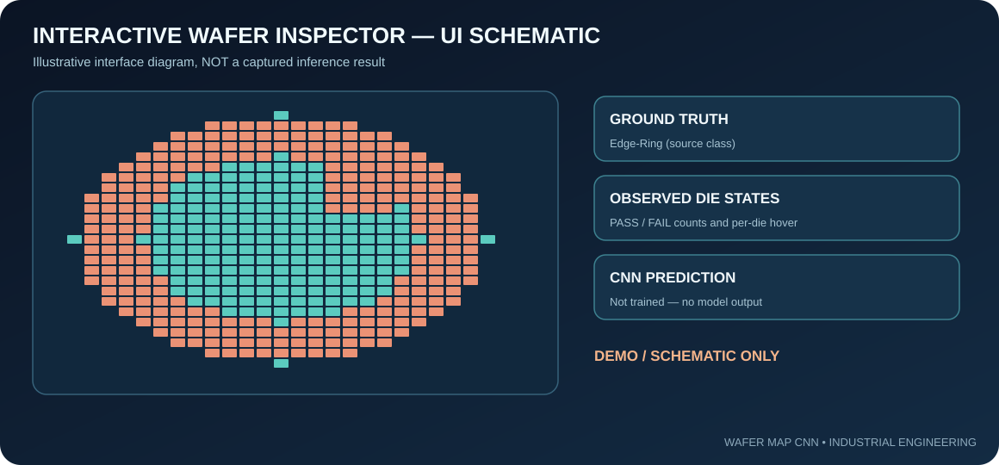

# Technical deep dive | CNN 기반 Wafer Map 분석

## 1. Scope / 분석 대상
This system classifies **electrical wafer-test spatial maps**, not individual nanoscopic defects in SEM images. A map contains a 52 × 52 die-state grid. Its values are 0 = outside, 1 = PASS and 2 = FAIL. The source is MixedWM38.

**한국어**: 웨이퍼의 전체 불량률이 같아도 불량 다이의 위치가 다를 수 있습니다. CNN은 국소 형상과 주변 다이의 공간적 연관성을 학습하는 기준 분류기로 사용했습니다.

## 2. Dataset and leakage controls / 전처리
- Original maps: 38,015, shape N × 52 × 52.
- Nine-class candidates: 8,015 (normal plus eight single-defect types); 30,000 mixed-type maps are outside this research scope.
- 105 maps contain die code 3, which has no verified meaning in the supplied description. Exclude complete maps, rather than guessing a recoding.
- Validated cohort: 7,910 maps. Train/validation/test separation is stratified, approximately 70/15/15.
- Normalization: the valid state 0/1/2 is divided by 2.0 before CNN input. Preserve full 2D geometry.
- Class weights are computed using the **training partition only**, avoiding direct use of held-out label proportions in model fitting.
- Check the original data license before redistribution. The repository intentionally does not include the raw source archive.

## 3. Baseline model architecture / 모델 설계
1. Input tensor — 52 × 52 × 1.
2. Conv2D with 32 filters, ReLU → MaxPooling2D.
3. Conv2D with 64 filters, ReLU → MaxPooling2D.
4. Conv2D with 128 filters, ReLU → MaxPooling2D.
5. GlobalAveragePooling2D.
6. Dense 128, ReLU → Dropout 0.3.
7. Dense 9, Softmax → scores over Normal, Center, Donut, Edge-Loc, Edge-Ring, Loc, Near-Full, Scratch, Random.

The script specifies Adam and sparse categorical cross-entropy. Early stopping monitors validation loss. Model architecture alone is not evidence of classification quality.

## 4. Interface architecture / 웹 검사 기능
Flask serves wafer-map arrays and recorded class labels. HTML Canvas plots die cells using color states. JavaScript handles sample switching, die hover readout and optional Top-5 prediction display when valid model weights are loaded. The UI must never display fabricated confidence if a model is absent.

## 5. Metric discipline / 평가 방법
After a genuine local train/test run, report held-out accuracy, macro-averaged F1, per-class precision/recall and confusion matrix. Compare rare Near-Full and Random classes separately. Include seed, split procedure, package versions, training logs and committed evaluation output. The present repository **does not contain verified model weights or such an evaluation result**.

## 6. Manufacturing relevance / 현장 적용 가능성과 한계
The model could support automated triage of visually recurring post-test patterns. Root cause analysis would require access to lot history, tool IDs, process recipes and downstream validation. There is no basis for a numerical factory-yield improvement claim from this student prototype.

## 7. Reproduction / 실행
1. Obtain a legitimate copy of the MixedWM38 source.
2. Install requirements for Python 3.11.
3. Set WAFER_DATA_PATH to the source NPZ.
4. Run tests first, then train_cnn.py for genuine measured metrics.
5. Run app.py and inspect source maps in the Flask UI.

[Source code](../train_cnn.py) · [Data QA](../wafer_data.py) · [Web API](../app.py) · [Dataset audit](DATA_AUDIT.md)
